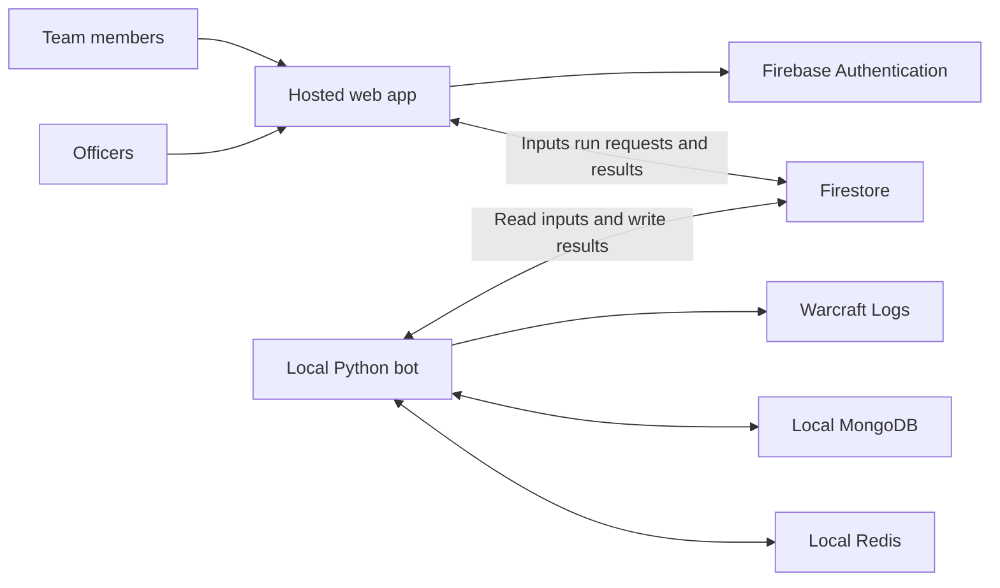

# Pebble web app architecture and workflow

Status: agreed architecture direction and proposed UI details.

Date: October 19, 2026.

Pebble will replace its Google Sheets interface with a hosted web app in the same
repository as the Python bot. Preserve the current interaction model: an officer
adds reports or edits overrides, clicks **Run Pebble**, and the local bot updates
the results. Successful output is immediately public. Officers inspect results
and make corrections whenever useful; there is no approval or publishing step.

## Decisions and scope

- Published results are readable without login. Google sign-in and a protected
  officer allowlist authorize input changes and runs.
- The browser uses the Firestore SDK directly. No hosted API is required.
- Firestore owns officer inputs, run status, and results. The bot runs locally,
  retaining MongoDB for source/intermediate data and Redis for WCL caching.
- Saving inputs does not start computation. Run Pebble is the explicit trigger.
- Every successful run calculates the season from the current enabled inputs and
  automatically replaces the public results as one complete set.
- Errors leave previous successful results visible. Warnings are informational
  and require no acknowledgement. Notes on adjustments are optional.
- Preserve existing calculation semantics, ranking order, and game-week grouping.
  Do not introduce new attendance policy as part of the interface migration.
- Start with one guild and one local worker. Avoid multi-tenant permissions,
  approval queues, mandatory audit events, and distributed worker machinery.

## Architecture and monorepo



Proposed web stack: React, TypeScript, Vite, and Firebase Hosting. The site is a
static app. Bot credentials and WCL secrets remain local; connections are outbound.
If the bot is offline, results remain readable and officers can save inputs and
queue a run.

Keep the Python package where it is and add the web app alongside it:

```text
pebble/                     Existing Python bot and calculation modules
tests/                      Python tests
apps/web/                   React and TypeScript app
firebase/
  firestore.rules           Browser access and input validation
  firestore.indexes.json    Query indexes as needed
  tests/                    Firestore emulator rule tests
firebase.json               Hosting and emulator configuration
docs/web-app-design.md      Design and user workflows
pyproject.toml              Python dependencies and commands
```

Reports, overrides, Google officer login, Firestore rules, public results, and the
local worker are implemented. See [app instructions](../apps/web/README.md) and
[setup instructions](firestore-setup.md). Standalone sample mode is available at
`?demo=1`. Dedicated roster and settings editors remain future work.

Keep Python and JavaScript dependencies independently managed; no shared package system is needed
initially. Extract structured pipeline inputs/results from the Sheets-facing CLI,
then add a Firestore adapter. Sheets can remain temporarily for output comparison,
but web-managed seasons have only one editable source of truth.

## Firestore data model

```text
officers/{uid}
bot/status
publicSeasons/{seasonId}

seasons/{seasonId}
  settings/calculation
  players/{playerId}
  characters/{characterId}
  reports/{reportCode}
  nightOverrides/{nightId}
  availabilityOverrides/{nightId_playerId}
  runs/{runId}
  results/{runId}
    nights/{nightId}          # Includes the nightly player breakdown array
    players/{playerId}
    weeks/{weekId}
```

There are three categories: editable inputs, private run records, and public-safe
results. There are no separate request, draft, approval, publication, or audit-event
collections. The run record is both the request and its eventual status/history.

Use stable player IDs rather than names as keys. Character IDs encode normalized
region, realm, and name; report IDs are canonical WCL codes. Store instants as UTC
Firestore timestamps and display in the guild timezone. Night/week IDs are ISO
dates using the existing calculation convention: Tuesday at midnight Pacific
starts the game week. Keep that behavior during migration.

### Inputs

| Document | Domain fields |
| --- | --- |
| Season root | Display name and season dates; configured by local administration initially |
| `settings/calculation` | Timezone, break window and duration bounds, default mythic start, extension settings |
| `players/{id}` | Main name, class, join/leave dates, active flag, optional private notes |
| `characters/{id}` | Region, realm, name, player ID |
| `reports/{code}` | Enabled flag, optional private notes |
| `nightOverrides/{night}` | Nullable break/mythic start/end timestamps, optional private notes |
| `availabilityOverrides/{night_player}` | Night ID, player ID, pre/post availability, optional private notes |

Every input document also has `version`, `updatedBy`, and `updatedAt`. Creates use
version 1; edits increment it. Forms save in a transaction that checks the version
originally loaded, so a concurrent edit prompts reload rather than silent overwrite.
There is no season-wide revision counter or required change-history document.

Disable a report to remove it from calculations. Use roster membership dates and
existing active semantics deliberately; ending membership and disabling a player
can affect history differently. Preserve the bot's established behavior and explain
it in the form. Keep character mapping semantics aligned with the current resolver;
unknown names remain visible warnings rather than a new mandatory resolution gate.

Deleting input documents is unnecessary initially: reports can be disabled, and
an override can be reset to automatic. This also keeps saved-input comparisons
simple. A future hard-delete feature must include deleted inputs in those comparisons.

Availability is a typed choice rather than a free-text spreadsheet value:

```json
{
  "nightId": "2026-10-15",
  "playerId": "player-example",
  "pre": {"mode": "automatic"},
  "post": {"mode": "partial", "minutes": 45},
  "notes": "Available after arriving late"
}
```

Modes are `automatic`, `available`, `unavailable`, `partial` (available for N
minutes), and `unavailableFor` (unavailable for N minutes). The last two accept
positive integer minutes. `unavailableFor` preserves the existing engine’s
negative-number override semantics without exposing signed numbers in the UI. Rules check shape and reasonable bounds; the bot
checks minutes against the actual half duration. Reset to automatic restores normal
inference. Notes are always optional and private.

WCL title, owner, dates, last checked time, and accessibility are derived output,
not editable report input. The browser normalizes URLs into report codes. The bot
fetches only the configured WCL API, never an arbitrary user-supplied URL.

### Runs and processing

An officer clicks Run Pebble to create `runs/{runId}` with exactly:

```json
{
  "status": "queued",
  "requestedBy": "officer-uid",
  "requestedAt": "<server timestamp>"
}
```

The bot adds the following fields as it processes the run:

| Field | Purpose |
| --- | --- |
| `status` | `queued`, `running`, `succeeded`, or `failed` |
| `startedAt`, `completedAt` | Run timing |
| `stage` | Validating, fetching reports, calculating, or updating results |
| `inputVersions` | Input document IDs/paths and versions actually consumed |
| `inputSnapshotHash` | Identity of the full input snapshot retained locally |
| `engineVersion` | Calculation code version |
| `reportSummaries` | Derived report metadata and last source check times |
| `warnings` | Nonblocking messages with links to relevant reports/players |
| `error` | Safe actionable failure message; raw traces stay local |

Inputs are captured when the bot starts, not when the officer clicks. Thus a run
queued while the bot is offline uses the latest saved inputs when it resumes.
The worker loads a consistent server-side input snapshot, using a read-only
Firestore transaction for the bounded input collection queries. Retain that snapshot
in MongoDB. Do not compute by repeatedly reading changing live inputs.

`inputVersions` lets the officer UI compare current inputs against the latest
successful run. An edit during computation does not invalidate the run: finish
and publish the captured snapshot, then show Changes not yet processed. The officer
can run again. Saving never creates an automatic follow-up run.

Run Pebble performs the existing ingest/compute pipeline and normal WCL refresh
behavior, respecting Redis caching. There is no separate source-refresh workflow
in V1. Report/source data changes appear on the next requested run.

Use one local process with a local singleton lock and process queued runs serially.
The browser disables repeated clicks while its request is pending; a second officer
may still queue another run, which is safe to process afterward. Use a stable
client-generated request ID for retries of the same submission. A completed run ID
is never processed again. On restart, mark interrupted running records failed with
an explanation and continue queued runs; officers can request a new run. Do not
add expiring distributed leases or claim-token protocols for a single local worker.

The local worker watches the oldest queued request with Firestore `on_snapshot`.
The callback only wakes the main thread, which claims and processes requests
serially. The SDK handles transient reconnects; a stopped listener is recreated
with bounded exponential backoff. No queue queries run on idle health checks.

`bot/status` is bot-written and officer-readable: last heartbeat and current run ID.
It supports an offline indicator without exposing machine details publicly.
Heartbeat writes occur once per minute. Progress is independent: write each run
stage immediately and subscribe to the run records in the UI. Never throttle
stage changes to the heartbeat interval. Keep the stage strip, current action,
and previous completed results visible while work runs; show completion or a
clear failure afterward.

### Results and automatic visibility

The bot writes a fresh result set under `results/{runId}` for each run. Its root
contains `complete: false` while uploading, then public-safe metadata: completion
time, source coverage, night count, and public warnings. Children contain nightly
player breakdowns, season player summaries/rankings, and weekly totals. Split data
into bounded documents rather than one large season payload.

Calculate aggregates from all current enabled inputs using the existing pipeline.
Do not select approved nights, construct impact previews, or copy forward selected
night versions. A disabled report removes its contribution on the next run. Ensure
local materializations exclude stale fights/nights left over from earlier inputs.

When upload finishes, one transaction:

1. Marks the result root `complete: true`.
2. Updates `publicSeasons/{seasonId}.latestRunId` and public completion/coverage fields.
3. Marks the private run record succeeded.

Only complete result sets are publicly readable. Failed validation, calculation,
or upload leaves the previous successful pointer intact. Completed result data is
immutable. This is an implementation safeguard, not an officer publication process.

The public UI loads the pointer and pins every query to that run ID. If it changes,
refresh the complete view together rather than mixing tables from different runs.
Old successful results may remain stored initially; no historical-version browser,
retention service, or rollback UI is required for V1. Record run IDs in private run
history for troubleshooting.

The public projection excludes officer UIDs, private notes, raw error details, and
credentials. Safe explanations can state that availability was overridden without
sharing the officer's note. Report links do not grant access to private WCL reports.

## Security rules contract

| Data | Officer browser | Anonymous browser |
| --- | --- | --- |
| Own officer membership | Read only | Denied |
| Season configuration and inputs | Read; validated input creates/updates | Denied |
| Run records | Read; create queued runs only | Denied |
| Bot status | Read only | Denied |
| Results | Read only, including incomplete output | Read complete output only |
| Public season directory | Read only | Read only |

Membership and season initialization are maintained locally. A signed-in user
without an enabled allowlist entry has only public access. No browser can change
membership, computed output, processing status, or the latest-result pointer.

Keep rules explicit per collection and default-deny unmatched paths. Validate:

- Allowed/required fields, types, identity fields, and numeric bounds.
- `updatedBy == request.auth.uid` and `updatedAt == request.time` for inputs.
- Version starts at 1 and increments by 1 on edits; immutable identity stays fixed.
- Run creation has only queued status, the authenticated requester, and server time.
- Public result root/child reads require that run's result root is complete.

Permit nullable timing overrides, optional bounded notes, and typed availability.
Check directly referenced player existence where straightforward; leave WCL access,
actual timing consistency, and calculation validity to the bot. No cross-document
history enforcement, approval transitions, or broad officer-write wildcard is needed.

Result children require explicit rules; parent permissions do not flow to children.
Public routes query one known complete result set. Rules are not filters over
mixed private and public documents. Private fields must live in private documents,
since Firestore reads authorize whole documents.

The Python server SDK uses IAM and bypasses browser rules. Credentials remain
local under a dedicated service account. The bot validates all inputs before use
and writes only public-safe fields into results. Browser rules and worker validation
are complementary, not interchangeable.

## UI navigation and shared behavior

Public navigation is Overview, Raid nights, and Players, with a season selector.
Officer sign-in adds Manage and keeps the public results accessible. Manage has
Reports, Overrides, Roster, and Settings. Run history is a small expandable panel
on Manage, not a separate officer inbox or activity system.

| Route | Purpose |
| --- | --- |
| `/seasons/:seasonId` | Latest successful season rankings and totals |
| `/seasons/:seasonId/nights` | Nights grouped by game week |
| `/seasons/:seasonId/nights/:nightId` | Played/bench breakdown and calculation explanations |
| `/seasons/:seasonId/players/:playerId` | Weekly and nightly player history |
| `/manage/:seasonId/reports` | Add/enable/disable reports and run the bot |
| `/manage/:seasonId/overrides` | Edit availability and timing |
| `/manage/:seasonId/roster` | Edit mains, membership dates, and character mappings |
| `/manage/:seasonId/settings` | Edit calculation settings |

Show public results time and source coverage. Missing data is not a zero. Keep the
existing ranking order and clear minute units. Use readable tables, WoW class
colors, and a restrained dark theme. Color supplements text; all forms have labels,
keyboard support, and inline errors. Mobile screens prioritize names and totals,
with secondary information expandable.

Officers see a shared Run Pebble button and a compact status strip throughout
Manage. Input forms use Save/Cancel; successful save means persisted to Firestore,
not processed. Do not accept offline form writes or show a run as queued until the
server confirms it. Unsaved forms disable Run Pebble in that view and explain
Save or discard your changes first. There is no hidden save-and-run behavior.

## Adding reports

Reports is the default officer landing screen:

```text
Pebble / Season                         Bot online   [View results]
Reports    Overrides    Roster    Settings

Last completed: 10:18 PM                 [Run Pebble]
Changes not yet processed

Add Warcraft Logs reports
[Paste report URLs or codes, one per line                         ]
[Add reports]

Report                         Raid night    Included   Last checked
Thursday progression           Oct 15        [Yes]      10:17 PM
Wednesday progression          Oct 14        [Yes]      10:17 PM
AbCdExample                    Not fetched   [Yes]      —

[Run history ▸]
```

Adding reports:

1. Paste one or several URLs/codes. Ignore whitespace and extract canonical codes;
   reject unsupported hosts and malformed codes inline.
2. Show per-line outcomes: Ready to add, Already added, Disabled report, or Invalid.
   Disable submission until invalid lines are fixed or removed. Already-added
   entries are skipped; disabled entries offer an explicit re-enable action.
3. Click Add reports. Save valid new entries as enabled. For a modest list, use an
   atomic batch so the UI does not imply the entire list saved after a partial failure.
4. Show Added 2 reports. Run Pebble to update results. Retain the unsaved text on error.
5. Click Run Pebble when ready. No extra review or confirmation is required.

Before the first run, display the report code and Not fetched. After processing,
show title, night, source link, last checked time, and any relevant warning. Report
metadata comes from run history; changing inclusion never erases useful last-known
metadata. Include/exclude controls save explicitly or show their pending Save state
consistently with other forms. Excluding a report explains that results change on
the next run and that shared/overlapping reports may still supply the same fights.

## Editing overrides

The Overrides screen starts with a raid-night selector based on computed nights,
plus an explicit date choice for entering adjustments before the first computation.
The page shows last successful results as context and clearly labels saved overrides
that have not yet been processed. Editing never changes the displayed calculated
numbers until Run Pebble finishes.

### Availability

```text
Night [October 15 ▾]                       [Run Pebble]
Last results: 10:18 PM

Player        Before break       After break        Effective bench
Example        Automatic ▾        Available ▾        27 min
Example       Automatic ▾        Partial ▾ [45 min] 60 min

[Add player adjustment]

Selected player: Example
Notes (optional) [                                                ]
[Cancel] [Save adjustment]
```

Selecting a player row opens a small editor with Before break and After break:
Automatic, Available, Unavailable, or Partial with a minutes field. Explain that
Automatic uses Pebble's inference; Partial describes available minutes, not extra
bench credit. Use a roster selector rather than free-text player names. Include
roster members absent from observed fights so officers can correct inferred absence.

Save updates that player's override document. Reset to automatic sets both halves
to automatic and clears its adjustment values. Saved explicit choices show an
Override badge, with the last calculated value beside them. Notes are optional and
private. Never require a reason or warning acknowledgement to continue.

### Raid timing

A separate Timing section shows the last detected break and mythic boundaries
alongside optional overrides. Empty fields mean Automatic. Date-aware controls
show the guild timezone and support midnight crossings. Validate paired values
where required and end after start. The bot checks consistency against actual
encounter data. A textual timing summary accompanies any timeline.

Each section has Save/Cancel and Reset to automatic. After saving, show Changes
not yet processed and keep Run Pebble available. Do not offer arbitrary edits to
final bench totals in V1; adjustments go through established calculation inputs.

## Run Pebble and results inspection

The routine workflow is:

1. Add reports or save overrides/roster/settings.
2. Click Run Pebble to create a queued run record.
3. Show Queued, then the bot's current stage. Disable duplicate clicks from that
   view while pending; use indeterminate progress rather than an invented percentage.
4. On success, show Results updated with a View results link and nonblocking warnings.
5. Inspect as desired, correct inputs, and click Run Pebble again.

The bot captures all saved inputs at start. If another officer saves changes during
a run, show Changes not yet processed after completion by comparing input versions.
Do not reject good output or automatically schedule more work. If inputs were
changed and then restored, the indicator can conservatively require another run.

On night results, officer-only actions Edit availability and Edit timing open the
corresponding override editor with that night/player selected. A compact player
detail panel explains played/bench pre/post totals, inferred availability, and the
applied override. A simple detected-versus-effective timing display helps diagnosis.
There is no mandatory review screen, impact preview, or approval button.

Unknown character warnings link to Roster to map an alt to an existing main or add
a player. Preserve current unknown-name handling and allow successful runs with
informational warnings. Errors that make results unreliable, such as inaccessible
required reports or invalid timing inputs, fail the whole run with a relevant edit
link; do not silently replace complete results with partial output.

| State | Behavior |
| --- | --- |
| Bot offline | Show last seen and Queued until bot returns; saving remains available |
| No runs yet | Explain Add reports, then Run Pebble; public site says no results yet |
| Unsaved form | Save/discard prompt before running or navigating away |
| Input changed by another officer | Preserve local edits and offer reload/compare on save conflict |
| Run failed | Keep public results, show actionable error and Run again |
| Inputs changed during run | Publish captured inputs; show remaining changes afterward |
| Successful run with warnings | Update results and show warning links without acknowledgement |
| Access revoked | Remove editing access; bot checks membership before starting queued runs |

Run history lists requester, start/end time, status, and error/warning summary. It
is troubleshooting support, not a compliance log. Retry after failure creates a
new run; retrying the network submission of the same request reuses its original ID.

## Delivery and verification

See [the implementation plan](web-app-implementation.md) for current status,
spreadsheet coverage, work packages, dependencies and cutover criteria. The
sequence below describes the overall delivery approach.

1. Extract typed pipeline inputs and structured outputs while preserving existing
   calculation tests. Make current enabled inputs determine local materializations
   so excluded reports do not leave stale fights or totals behind.
2. Add the Firestore adapter, membership administration, simple rules, and a single
   local run worker. Test consistent input capture and complete result replacement.
3. Build Reports, Overrides, and Run Pebble against representative sample data,
   alongside public overview/night/player views.
4. Add roster/settings editing and contextual result explanations. Exercise two
   officers editing, a bot restart, and input changes during a run.
5. Compare a migrated season against established output, then switch its editable
   interface from Sheets to the web app.

The attendance probability model currently lives in Google Apps Script. Port it
to Python with numerical checks when replacing that view. A what-if planner can
follow the core report/override/results flow; keep assumptions visible.

Rule tests cover non-officer writes, membership escalation, computed-data writes,
unknown fields, forged timestamps/UIDs, version checks, invalid availability, run
creation constraints, and anonymous access to incomplete/private data. Worker tests
cover source/input validation, warnings, source caching, stable snapshots, stale
materializations, interrupted runs/uploads, repeat submission, and safe public
field projection. A failed run must never replace the previous successful results.

## Firebase references

- [Field validation and whole-document read access](https://firebase.google.com/docs/firestore/security/rules-fields)
- [Rule conditions and server SDK authorization](https://firebase.google.com/docs/firestore/security/rules-conditions)
- [Transactions and atomic writes](https://firebase.google.com/docs/firestore/manage-data/transactions)
- [Queries and security rules](https://firebase.google.com/docs/firestore/security/rules-query)
- [Firebase Hosting](https://firebase.google.com/docs/hosting)
